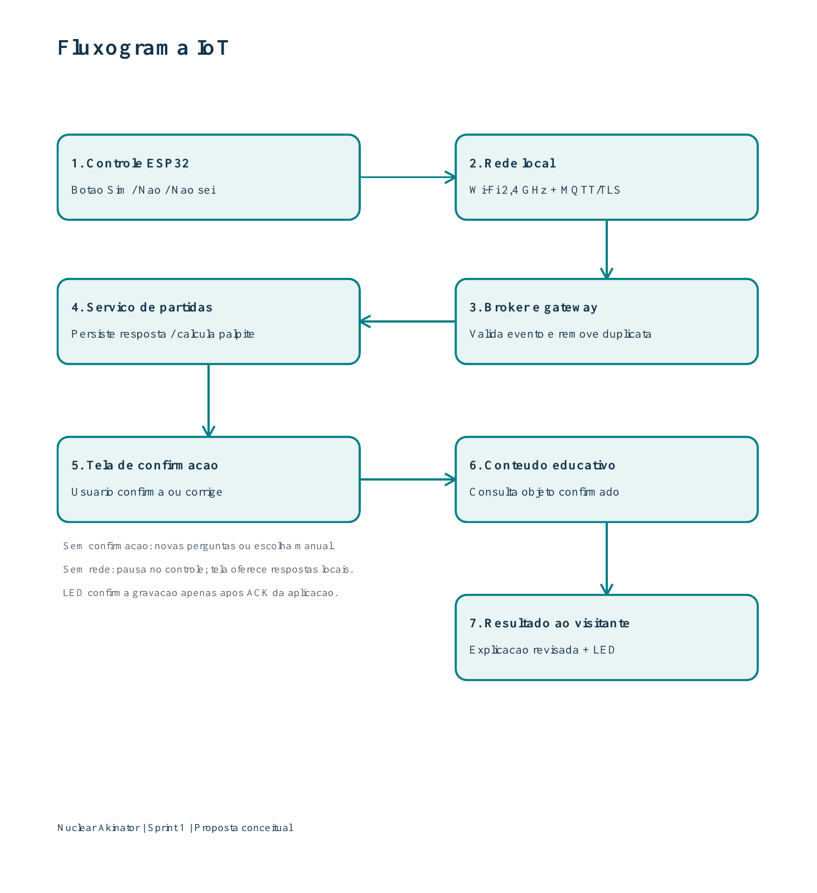

# Nuclear Akinator - IoT e Redes - Sprint 1

## Equipe

- Caio Cantini Couto - RM 563452
- Guilherme Pinto Eustáquio - RM 566784
- Matheus Tavares - RM 566844

## Problema e objetivo

A tecnologia nuclear ainda é pouco compreendida por parte da sociedade. O Nuclear Akinator utiliza um jogo de adivinhação para apresentar objetos e alimentos do cotidiano e explicar sua relação com a radiação e a tecnologia nuclear.

## Proposta de aplicação de IoT

Um controle físico conectado ao jogo permitiria responder por três botões: **Sim, Não e Não sei**. A tela apresentaria perguntas, palpites, confirmação do objeto e explicação científica.

O controle seria instalado ao lado de um monitor ou tablet em exposições, feiras de ciências e salas de aula. A proposta é conceitual.

## Componentes e funções

| Componente | Função | Local previsto |
|---|---|---|
| ESP32 com Wi-Fi | Ler os botões e transmitir as respostas. | Dentro da caixa do controle. |
| Três botões físicos | Capturar as escolhas Sim, Não e Não sei. | Painel frontal com texto e símbolos. |
| LED de estado | Sinalizar conexão, envio pendente e resposta aceita. | Parte superior do controle. |
| Fonte USB e caixa | Alimentar e proteger a eletrônica. | Mesa, com cabos fixados. |
| Roteador Wi-Fi 2,4 GHz | Conectar os dispositivos à rede local. | Área de cobertura do espaço educativo. |
| Computador local | Executar o broker MQTT e o gateway; poderia hospedar os serviços do jogo. | Área técnica do mediador. |
| Monitor ou tablet | Apresentar perguntas, confirmação e conteúdo educativo. | Ao lado do controle. |

Os botões coletariam as ações do visitante. O LED atuaria como sinalizador. O controle não mediria radiação dos objetos ou alimentos.

## Comunicação e dados coletados

O ESP32 enviaria as escolhas pela rede Wi-Fi usando MQTT com TLS. O broker distribuiria as mensagens ao gateway, responsável por validá-las e encaminhá-las ao serviço de partidas por HTTPS/JSON.

Cada evento conteria a resposta e os identificadores da partida, da pergunta, do terminal e do próprio evento. O serviço registraria o instante de recebimento e armazenaria a resposta no banco Oracle. O catálogo Java forneceria os objetos e suas explicações científicas.

## Fluxograma de funcionamento

1. O visitante pressiona um dos três botões.
2. O ESP32 captura a escolha e a transmite pela rede local.
3. O broker encaminha o evento ao gateway, que valida a sessão e a pergunta e evita gravações duplicadas.
4. O serviço registra a resposta e atualiza os objetos candidatos. A resposta Não sei é neutra.
5. A tela apresenta um palpite, e o visitante confirma ou corrige o objeto.
6. Após a confirmação, a aplicação consulta e exibe a explicação científica do objeto escolhido.

O LED sinalizaria o aceite após o registro da resposta. Se o palpite estivesse incorreto, o jogo permitiria novas perguntas ou a correção do objeto. Em caso de falha de conexão, o controle pausaria e a tela ofereceria respostas por toque ou teclado.

## Uso dos dados e benefício esperado

O motor do jogo utilizaria as respostas para orientar a adivinhação. O visitante receberia o resultado educativo pela tela. O mediador poderia identificar perguntas que geram dúvidas e melhorar seus enunciados.

A aplicação de IoT ofereceria uma interação física compartilhada, sem exigir celular pessoal. A explicação científica permaneceria vinculada ao objeto confirmado pelo visitante.

## Documentação

- [Proposta de IoT e Redes](Proposta_IoT_Redes.pdf)
- [Fluxograma em PDF](diagramas/Fluxograma_IoT.pdf)
